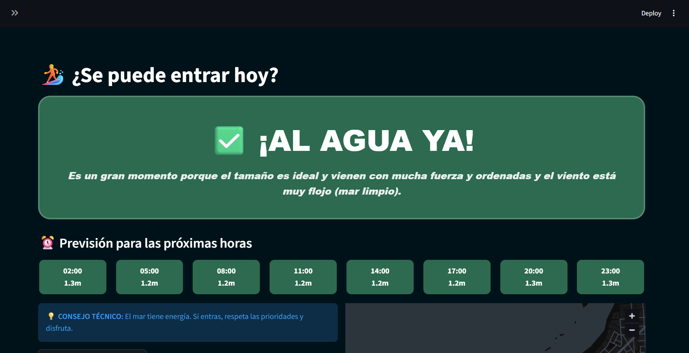

# 🏄 Surf Decision Gran Canaria (DSS)

[](https://surf-dashboard-gc.streamlit.app/)
[](https://www.python.org/)
[](https://streamlit.io/)
[](https://plotly.com/)
[](LICENSE)

An intelligent oceanographic **Decision Support System (DSS)** and real-time dashboard for surfers across Gran Canaria's prime breaks (La Cícer, El Confital, La Laja, San Andrés).

Instead of forcing users to decipher raw buoy tables and meteorological charts, this application processes multi-variable oceanographic forecasts into actionable decisions: **"Paddle Out Now!"** vs. **"Stay Home"**.



---

## ⚡ Core Features

- **Dynamic Heuristic Decision Engine:** Synthesizes wave height ($H_s$), wave period ($T_p$), wind speed, and direction against spot-specific bathymetry profiles.
- **Golden Hour Traffic-Light Forecast:** 24-hour predictive breakdown identifying the peak tidal and swell windows.
- **Live Webcam Validation:** In-app webcam feeds for instant visual ground-truth confirmation before commuting.
- **Multivariate Ingestion:** Automated querying of [Open-Meteo](https://open-meteo.com/) Marine & Weather forecast APIs.
- **Geospatial Spot Mapping:** Interactive 3D maps and technical coordinates built with PyDeck and Leaflet.
- **Historical Query Persistence:** SQLite backend tracking spot condition trends and query logs.

---

## 🏗️ Tech Stack

- **Application & Dashboard:** Python, Streamlit
- **Data Engineering & Analysis:** Pandas, NumPy
- **Interactive Visualizations:** Plotly Express, PyDeck (3D maps)
- **Data Persistence:** SQLite3
- **APIs:** Open-Meteo Marine API, Open-Meteo Weather API

---

## 🚀 Getting Started

### Prerequisites

- Python 3.10+
- `pip`

### Installation & Local Run

```bash
# 1. Clone repository
git clone https://github.com/yonillo/Surf-Dashboard-gc.git
cd Surf-Dashboard-gc

# 2. Create virtual environment
python -m venv .venv
source .venv/bin/activate  # On Windows: .venv\Scripts\activate

# 3. Install requirements
pip install -r requirements.txt

# 4. Launch Streamlit app
streamlit run app.py
```

---

## 🌐 Live Deployment

Access the production deployment on Streamlit Cloud:  
👉 **[surf-dashboard-gc.streamlit.app](https://surf-dashboard-gc.streamlit.app/)**

---

## 👨‍💻 Author

**Yone Suárez Viera**  
Data Science & Engineering Student @ ULPGC | Gran Canaria 🏝️  
- **LinkedIn:** [yone-suarez](https://linkedin.com/in/yone-suarez)
- **Portfolio:** [yonesuarez.es](https://yonesuarez.es)
